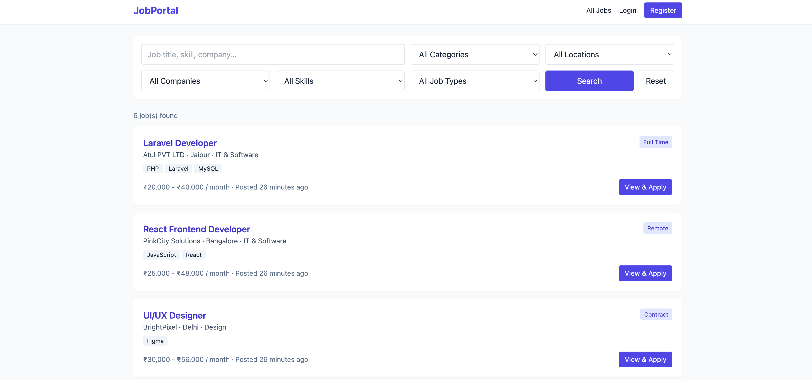
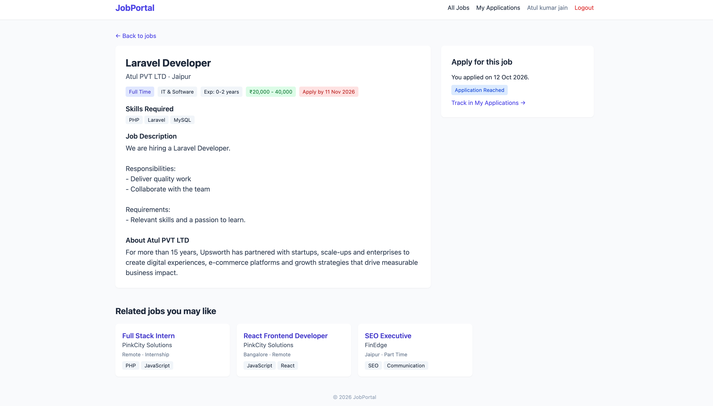
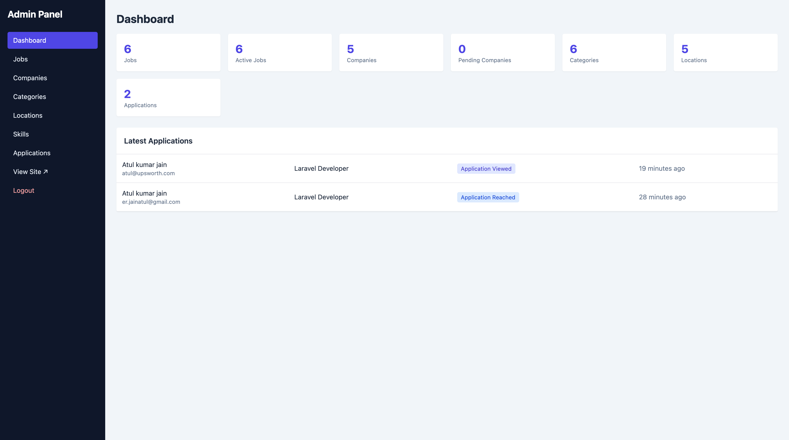
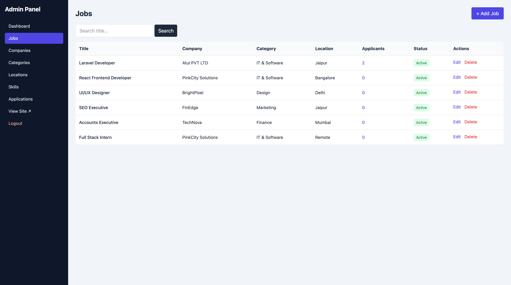
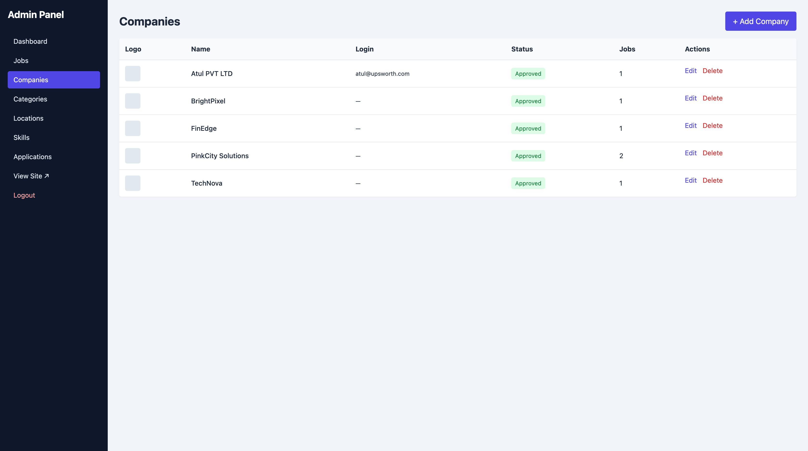
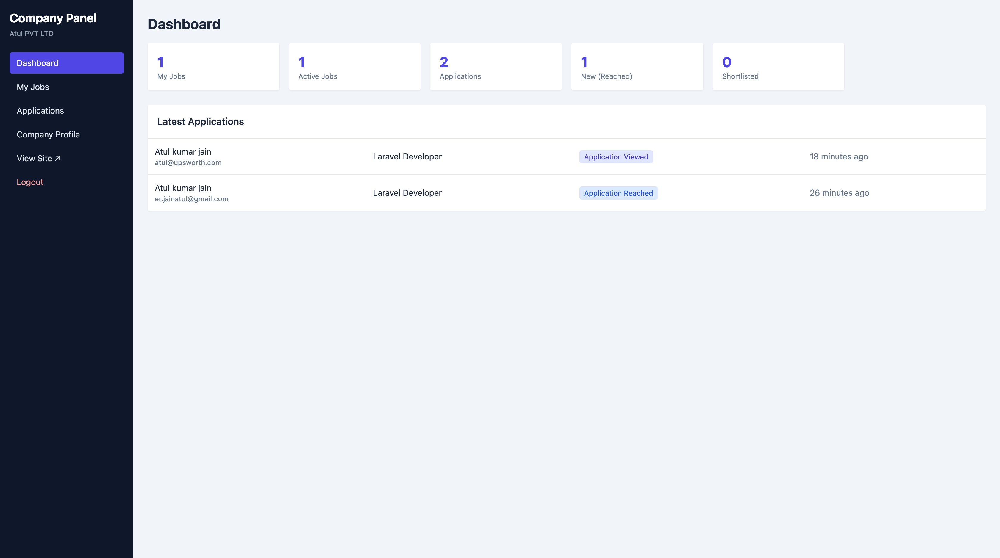
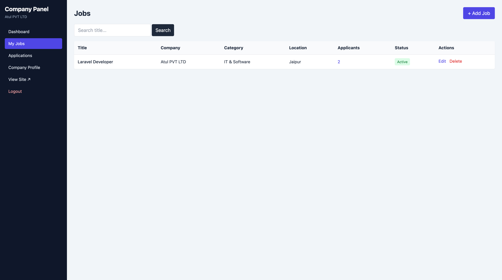

# Job Portal

A full-stack job portal built with **Laravel** and **MySQL**. Candidates can search and filter jobs and apply with a resume, companies can post and manage their own jobs, and admins manage the whole platform.

## Features

### Candidates
- Browse all jobs with filters: keyword, category, location, company, skill and job type
- Job detail page with skills, salary, experience and deadline
- Apply with name, phone, cover letter and resume upload (PDF/DOC)
- Email confirmation after applying
- **My Applications** page with status tracking: Application Reached, Viewed, Under Review, Shortlisted, Rejected, Cancelled
- Cancel an application (and re-apply later)
- Related job suggestions at the bottom of every job page

### Companies
- Self-registration (admin approval required before jobs go public) or account created by admin
- Add, edit, delete and activate/deactivate their own jobs
- View applicants for their jobs, download resumes and update application status
- Edit company profile and logo
- Email notification when someone applies

### Admin
- Dashboard with statistics and latest applications
- Manage jobs, companies, categories, locations and skills
- Approve or pause company accounts
- Create company logins
- Manage all applications

## Tech Stack
- PHP 8.2+, Laravel 11
- MySQL
- Blade templates, Tailwind CSS (CDN)
- Laravel Mail for notifications

## Roles
| Role | Access |
|------|--------|
| Admin | Everything |
| Company | Own jobs, own applicants, own profile |
| User | Browse, apply, track applications |

## Screenshots

### Public
| Jobs list | Job details |
|-----------|-------------|
|  |  |

### Admin
| Dashboard | Add job |
|-----------|---------|
|  |  |

| Companies listing |
|-------------------|
|  |

### Company
| Dashboard | Add job |
|-----------|---------|
|  |  |

## Installation

```bash
git clone https://github.com/YOUR_USERNAME/job-portal.git
cd job-portal
composer install
cp .env.example .env
php artisan key:generate
```

Create an empty MySQL database named `job_portal`, then set these values in `.env`:

```env
DB_CONNECTION=mysql
DB_HOST=127.0.0.1
DB_PORT=3306
DB_DATABASE=job_portal
DB_USERNAME=root
DB_PASSWORD=

MAIL_MAILER=log
MAIL_FROM_ADDRESS=jobs@example.com
MAIL_FROM_NAME="Job Portal"
```

Run the migrations and start the app:

```bash
php artisan migrate --seed
php artisan storage:link
php artisan serve
```

Open http://127.0.0.1:8000

**Alternative:** import `database/job_portal.sql` in phpMyAdmin instead of running `php artisan migrate`.

With `MAIL_MAILER=log`, emails are written to `storage/logs/laravel.log`. Use SMTP details (for example Mailtrap or Gmail) to send real emails.

## Demo Logins (local only)
| Role | Email | Password |
|------|-------|----------|
| Admin | admin@example.com | password |
| Company | company@example.com | password |

Change these credentials before deploying anywhere public.

## Database Overview
- `users` (roles: admin, company, user)
- `companies`, `categories`, `locations`, `skills`
- `job_listings` and `job_listing_skill` (many-to-many)
- `applications` (status and resume path)

The jobs table is named `job_listings` because Laravel already uses `jobs` for queues.

## Future Improvements
- Queue emails for faster applications
- Email candidates when their status changes
- Job alerts and saved jobs
- Automated tests
- REST API

## Author
**Your Name**
GitHub: [@YOUR_USERNAME](https://github.com/YOUR_USERNAME)
LinkedIn: add your link here
